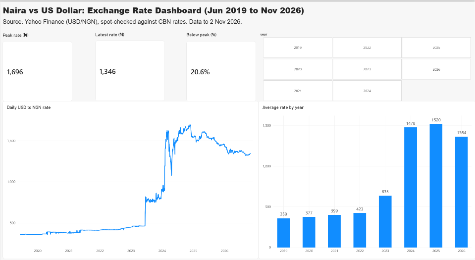
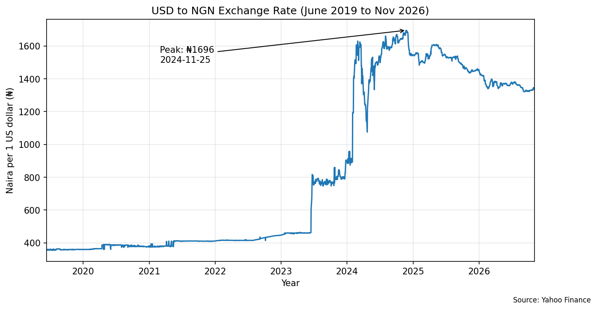
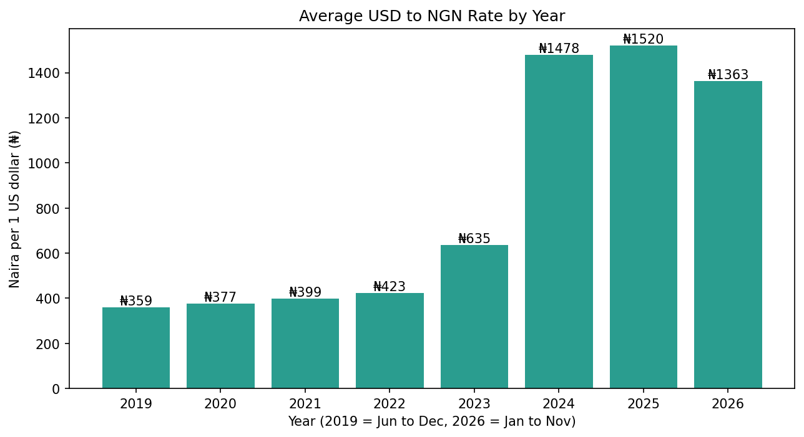

# Naira vs US Dollar: Exchange Rate Analysis (2019 to 2026)

Python analysis of how the USD to NGN exchange rate changed from June 2019 to November 2026, built in Google Colab with pandas and matplotlib.

## Questions
- How has the naira moved against the dollar since 2019?
- Which years saw the biggest change?
- Where is the rate now compared with its peak?

## Key findings
- The yearly average rate rose slowly from 2019 to 2022 (about 5 to 6% a year), from ₦359 to ₦423.
- It jumped 50.1% in 2023 (to ₦635) and 132.8% in 2024 (to ₦1,478).
- The rate peaked at about ₦1,696 on 25 November 2024.
- 2025 averaged ₦1,520 (+2.8%), and 2026 so far averages ₦1,364 (-10.3%).
- On 2 November 2026 the rate was about ₦1,346 per dollar, about 21% below the 2024 peak.

## Charts

## Method
1. Downloaded daily USD/NGN closing rates with the `yfinance` library (ticker `NGN=X`).
2. Checked for missing values and duplicate dates (none found).
3. Found suspicious values in June 2019 where the data switched rate sources, so I kept data from 12 June 2019 onwards.
4. Calculated yearly averages and year-on-year % change, then plotted the results.
5. Built an interactive Power BI dashboard (KPI cards, daily rate line chart, yearly average chart and a year filter) from the cleaned data, ending at 2 November 2026.

## Limitations
- Data comes from Yahoo Finance, which may differ from the official CBN rate. I spot-checked 20 days in Nov to Dec 2025 and recent weeks in Oct to Nov 2026 against CBN published closing rates. Differences were under ₦14 (less than 1%). Older values, including the 2024 peak, were not independently confirmed.
- 2019 covers June to December only, and 2026 covers January to early November only.
- The data shows sudden one-day jumps in early 2024 that look like source changes rather than real daily moves, so I compared yearly averages instead of single-day changes.
- The Power BI dashboard excludes the unfinished day of 3 November 2026, so the 2026 average shows as ₦1,364 there and ₦1,363 in the Colab notebook.

## Tools
Python, pandas, matplotlib, yfinance, Google Colab, Power BI
